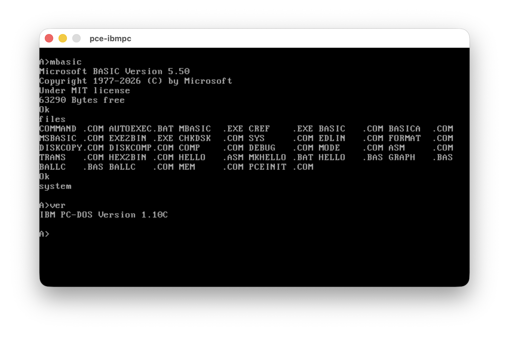
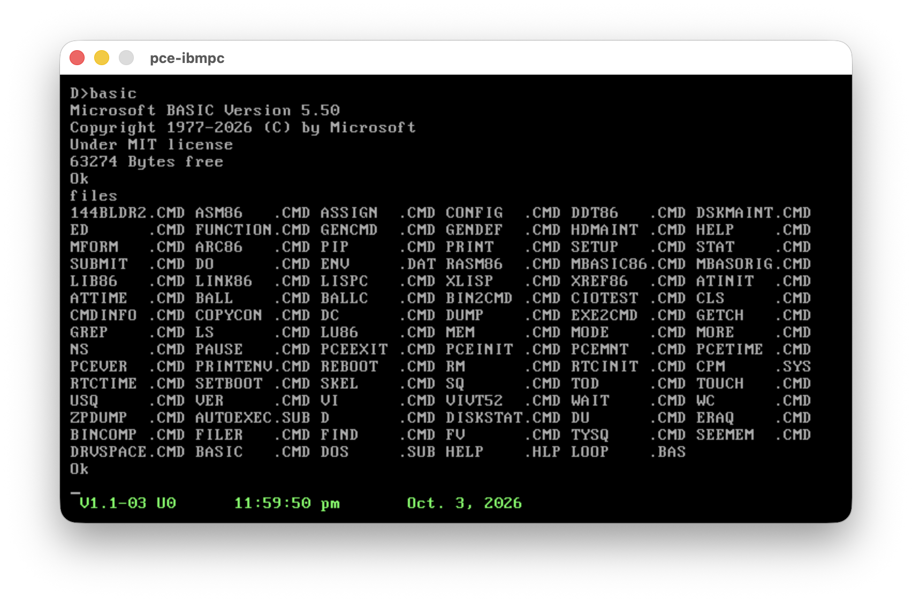
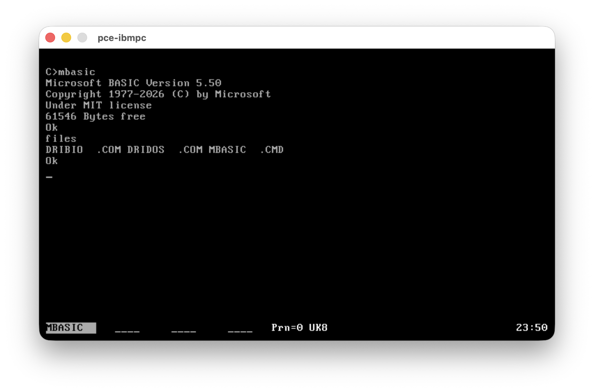
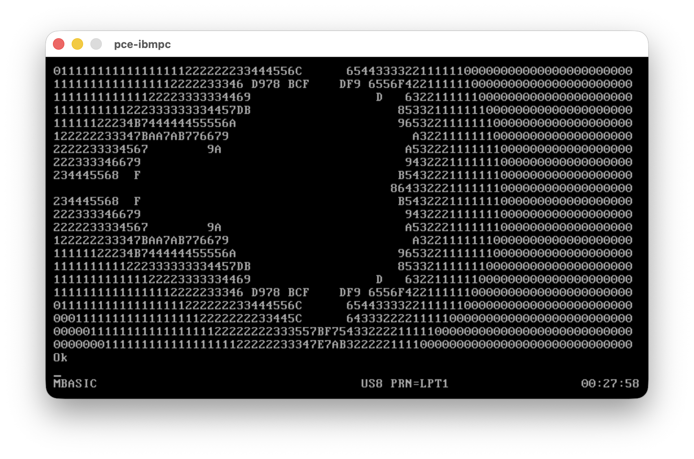

# MBASIC 5.50B — ROM-able BASIC-86 for MS-DOS and CP/M-86

A text-mode Microsoft BASIC interpreter rebuilt from the 1983 GW-BASIC sources specifically for FCB DOS and CP/M-86 family:
graphics and PC hardware removed, tokens and behaviour aligned on MBASIC 5.28/ MBASIC-86 5.22.
one source tree producing an MS-DOS `.COM` and a CP/M-86 `.CMD`.

GW-BASIC is also integrated to the companion project [msdos40-kernel](https://github.com/tsupplis/msdos40-kernel) with the explicit goal to be a 3.23 compatible replacement.

A similar but far more advanced approach can also be found at [gw-basic-2026](https://github.com/evvaletov/gw-basic-2026). If you intent to work on *nix and more recent ms-dos environment, have a look at it.

Another interesting project is [mbasic 5.21 reconstruction](https://github.com/avwohl/mbasic2025).

## 1. Why and what

| | |
|---|---|
| Why | Fun, nostalgia and history: get a working, buildable Microsoft BASIC-86 back from published source |
| Source | [microsoft/GW-BASIC](https://github.com/microsoft/GW-BASIC) (1983, MIT) |
| Result | MBASIC 5.50B: everything MBASIC 5.28 does, nothing PC specific, Works on both DOS and CP/M |
| Rule | May do more than 5.28 / 5.22, never less |
| Manual | [docs/basic-5.0.pdf](docs/basic-5.0.pdf): BASIC-80 5.0 reference manual, also valid for this version (5.50 follows the 5.x language) |

### The family, as far as the sources tell

| Product | Year | CPU / OS | Relation |
|---|---|---|---|
| Altair BASIC | 1975 | 8080 | Origin of `BINTRP` ("Bill Gates and Paul Allen", Monte Davidoff math) |
| BASIC Rev. 4.51 [CP/M Version] | 1977 | 8080 / CP/M-80 | Earlier CP/M release (banner: "Copyright 1977 (C) by Microsoft"), before the 5.x line and MBASIC.COM naming; not part of these sources, binary kept in `ref/` |
| BASIC-80 (MBASIC) 5.21 | ~1981 | 8080 / CP/M-80 | Disk BASIC 5.x, the language MBASIC users know |
| BASIC-86 5.22 | 1982 | 8086 / CP/M-86 | 5.x mechanically translated from 8080 to 8086 (headers: "translation created … by Version 4.3") |
| MBASIC 5.28 | 1983 | 8086 / MS-DOS | Same 5.x line on MS-DOS; adds BLOAD/BSAVE, CALLS, DATE$, TIME$ |
| GW-BASIC | 1983 | 8086 / MS-DOS | Same translated core + generalized I/O (GIO), screen editor, graphics, sound, events |
| **MBASIC 5.50B** (this) | 2026 | 8086 / MS-DOS, CP/M-86 | GW-BASIC core minus PC specifics, 5.28 tokens and behaviour, teletype console |

## 2. Runs on

Quick start-up checks (banner, `FILES`, program entry) on PCE/ibmpc; not an extensive test.

<p align="center">


<br><sub>PC-DOS 1.10 (.EXE) &nbsp;·&nbsp; CP/M-86 1.1 (.CMD)</sub><br>


<br><sub>Concurrent DOS 4.1 (.CMD) &nbsp;·&nbsp; DOS Plus 1.2 (.CMD)</sub>
</p>

| Platform | Status | Notes |
|---|---|---|
| MS-DOS / PC-DOS 1.10+ | ✔ checked on PC-DOS 1.10 | Only DOS 1.x calls (00h–2Eh), FCB files, 8.3 names, no paths |
| MS-DOS 2.x–6.x | ✔  checked on MS-DOS 6.22 | Same binary |
| CP/M-86 1.1 (BDOS 2.2) | ✔ checked | DATE$/TIME$ → "Illegal function call" (no BDOS clock API) |
| Personal CP/M-86 2.0 | Clock tested in PCE | BDOS 105 read / 104 write |
| Concurrent CP/M-86 1.0 and 3.1, Concurrent DOS 3.2, 4.1 and XM 6.21 | Clock tested in PCE | Same interface |
| DOS Plus 1.2 | Clock tested in PCE | Minute-resolution writes |
| CP/M-86 Plus | Separate guest unverified | Requires compatible BDOS 105/104 services |
| Any 8086/8088 machine | ✔ | No BIOS, video or port access by the interpreter |
| emu2-cpm86 (DOS and CP/M-86) | ✔ fully tested | All `tests/` run here |

**CP/M file lengths.** BASIC requests the final record's byte count on Concurrent
CP/M 3.1 and later Concurrent DOS, Personal CP/M 2.0 and DOS Plus 1.2.
Sequential writes store the count at close. After reopening, `LOF` includes
the bytes BASIC wrote, including its final Ctrl-Z. Binary data ending in
zero or Ctrl-Z is preserved. Random `GET` and `PUT` still transfer fixed
records. CP/M-86 1.1, Concurrent CP/M 1.0 and unrecognized BDOS versions
use 128-byte record lengths. A zero byte count denotes a full final record,
including on older files with no recorded count. Text input still recognizes
Ctrl-Z, and append retains that convention on these record-sized files.

To check a guest, copy `tests/length.bas` as CP/M text and the current
`MBASIC86.CMD` to a scratch disk. Run `RUN "LENGTH"` in BASIC and enter
`1` for byte counts or `0` for record lengths. A successful run prints
`LENGTH PASS`.

On the tested clock-capable guests, `DATE$` accepts dates from 1978 through
2099. BDOS day 1 is January 1, 1978. `TIME$` reads hours, minutes and
seconds. Setting either value writes the combined BDOS timestamp: a date
assignment preserves hours and minutes, a time assignment preserves the date,
and the OS resets seconds to zero. Inline BASIC programs can observe the
clock ticking normally across midnight.

To repeat the clock checks, run
`python3 tests/clockpce.py CONFIG BOOT DATA minute` with a system disk
and a data floppy containing the current `MBASIC86.CMD` on B:.
Use `unsupported` for CP/M-86 1.1, `--program-drive a` for a program on the
boot floppy, or `--hard-disk` for an XM hard-disk boot configuration.
The harness copies both images before starting PCE and checks literal
BASIC values, error messages and the year transition at midnight.

| Binary | Size | Memory |
|---|---|---|
| `build/dos/mbasic86.com` | ~34 KB | 64 KB data segment |
| `build/cpm/mbasic86.cmd` | ~35 KB | code group + data group up to 64 KB |

## 3. Command line

`mbasic86 [file] [options]`: the optional program file is loaded and run, options start with `/` and may come before or after the file name (only one file name allowed). Anything else gives "Error detected in command line".

| Option | Effect |
|---|---|
| `/F:n` | Number of files: accepted for compatibility, ignored (files are dynamic) |
| `/S:n` | Maximum record size: accepted for compatibility, ignored (records are dynamic) |
| `/M:n` | Limit the data segment to n bytes (decimal or `&H` hex), e.g. `/M:&HC000` leaves 46922 bytes free instead of 63290; more than is available is refused |
| `/NOB[ANNER]` | No banner and no "Bytes free" message (5.50 extension) |
| `/NOR[UN]` | Load the program but do not run it, stay at `Ok` (5.50 extension) |

Option names are case-insensitive and may be abbreviated down to three letters (`/NOB`, `/NOR`). Examples: `mbasic86 pspdump`, `mbasic86 /nob /nor pspdump`, `mbasic86 prog /m:&HC000`.

## 4. Feature parity

| Area | 5.22 CP/M-86 | 5.28 DOS | GW-BASIC | 5.50B |
|---|---|---|---|---|
| Tokens (tokenised programs interchangeable) | 131 keywords | 136 keywords | own numbering | **5.28 numbering, 136** |
| Core language, math, strings, PRINT USING, arrays, DEF FN | ✔ | ✔ | ✔ | ✔ |
| WHILE/WEND, CHAIN/COMMON/MERGE, ON ERROR/RESUME | ✔ | ✔ | ✔ | ✔ |
| Sequential/random files, FIELD/LSET, FILES/KILL/NAME | ✔ | ✔ | ✔ | ✔ |
| OPEN "A" (append) | ✘ | ✔ | ✔ | ✔ |
| BLOAD/BSAVE, CALLS | ✘ | ✔ | ✔ | ✔ |
| DATE$, TIME$ | ✘ | ✔ | ✔ | ✔ |
| PEEK/POKE/DEF SEG/USR/CALL/INP/OUT/WAIT | ✔ | ✔ | ✔ | ✔ (WAIT breakable with ^C) |
| USR "undefined" check (slot = `FFFF`) | ✘ byte compare `CMP DL,0FFh`: `DEF USR` address `&HxxFF` gives "Illegal function call" | ✔ word compare | ✔ word compare | ✔ word compare, both targets |
| SAVE ,A | ✔ | ✔ | ✔ | ✔ |
| SAVE ,P (protected: `FE` header, XOR-encoded; LIST/EDIT/PEEK/POKE/binary SAVE blocked) | ✔ | ✔ | ✔ own tokens | ✔ files interchangeable with 5.28 both ways |
| EDIT line editor (D C S K I X H L A E Q) | ✔ | ✔ | full screen | ✔ MBASIC style |
| AUTO, RENUM, DELETE, TRON/TROFF, NULL | ✔ | ✔ | ✔ (no NULL) | ✔ |
| Input keys ^U ^X ^R ^O, rubout `\x\`, ^C/^S | ✔ | ✔ | screen keys | ✔ |
| Device names KYBD: SCRN: LPT1: | ✘ | partial | ✔ | ✔ |
| Division by zero trappable by ON ERROR | ✘ | ✔ | ✔ | ✔ |
| ERR 57 message | "Disk I/O error" | "Device I/O Error" | "Device I/O Error" | CP/M-86: "Disk I/O error", DOS: "Device I/O Error" |
| ERR 68 message | Unprintable error | Unprintable error | "Device Unavailable" | "Device Unavailable" (device names) |
| Command line `/F:` `/S:` `/M:` | ✔ | ✔ | ✔ | ✔ (`/F:` `/S:` accepted, ignored: files and records are dynamic) |
| Command line `/NOB[ANNER]` (no banner, no "Bytes free"), `/NOR[UN]` (load the program, don't run it) | ✘ | ✘ | ✘ | ✔ before or after the file name, e.g. `mbasic86 /nob pspdump` (5.28 accepts options only after the file name) |
| Graphics, sound, CLS/LOCATE/COLOR/SCREEN, KEY | ✘ | ✘ | ✔ | ✘ removed |
| COM:, light pen, joystick, cassette, events (ON KEY…) | ✘ | ✘ | ✔ | ✘ removed |
| CHDIR/MKDIR/SHELL/ENVIRON, VARPTR$, Kanji | ✘ | ✘ | ✔ | ✘ removed |

Verification: identical to 5.28 (DOS) and 5.22 (CP/M-86) on all `tests/`
scripts except the reviewed extras in `tests/accept/dos` and `tests/accept/cpm`;
both builds identical to each other except ERR 57's wording and an emulator
limit (`tests/accept/parity`).

## 5. Dependencies

| What | Where | Used for |
|---|---|---|
| cpm86-crossdev | https://github.com/tsupplis/cpm86-crossdev | `pcdev_masm` (MASM 5.10), `pcdev_link` (LINK 3.65a), `cmdinfo` |
| emu2-cpm86 | https://github.com/johnsonjh/emu2-cpm86 | runs the DOS tools, both builds and the reference BASICs |
| GNU make, python3, unix2dos | host | build scripts, test driver, CMD packer |
| Reference binaries | `ref/` | test oracles, see below |

| Reference binary | Version | Target | Used by |
|---|---|---|---|
| `ref/mbasic86.com` | MBASIC 5.28 | MS-DOS | `make test` (DOS) |
| `ref/mbasic86.cmd` | BASIC-86 5.22 | CP/M-86 | `make TARGET=cpm test` |
| `ref/mbas521.com` | MBASIC 5.21 | CP/M-80 | reference only (not used by tests) |
| `ref/obas451.com` | BASIC Rev. 4.51 | CP/M-80 | reference only (not used by tests) |

## 6. Build and test

| Command | Does |
|---|---|
| `make` | both targets |
| `make dos` / `make cpm` | one target (`build/dos/mbasic86.com`, `build/cpm/mbasic86.cmd`) |
| `make run` / `make TARGET=cpm run` | start the interpreter under emu2 |
| `make test` / `make TARGET=cpm test` | every `tests/*.txt` on reference and build, diff |
| `make parity` | every test on both builds, diff |
| `make testall` | the three suites (dos, cpm, parity) in parallel, logs in `build/test-*.log`, PASS/FAIL summary |
| `make DEBUG=1 …` | build with error tracing |
| `make dist` | flat `build/mbasic.zip`: `mbasic86.com`, `mbasic86.cmd`, reference `mbas528.com` (5.28), `mbas522.cmd` (5.22), `mbas521.com` (5.21 CP/M-80), `obas451.com` (4.51 CP/M-80), `LICENSE.md` |
| `make clean` | remove `build/` |

| Layout | |
|---|---|
| `*.asm`, `*.inc` | interpreter (MASM 5.10), `oem.inc` switches, `cfg.inc` generated per target |
| `giotty.asm`, `oemio.asm` | teletype console, line editor, OS primitives |
| `tools/` | `runbas.py` test driver, `mkcom.py` EXE→COM, `mkcmd.py` EXE→CMD, `normout.sh` |
| `tests/` | scripts (`\k` ^C, `\e` ESC, `\^X` control keys, first line `#args:` = command line, `NAME.bas` companion file), `accept/` reviewed differences |
| `examples/` | `ivtdump.bas`: 8086 interrupt vector table (`DEF SEG=0`, `PEEK`); `pspdump.bas`: MS-DOS PSP / CP/M-86 base page at BASIC's DS:0 (`DEF SEG`, `PEEK`); `beep.bas`: PC speaker beep (`OUT`, `INP`, PC hardware only). emu2 shows placeholder vectors; real values on real hardware |

### IBM PC standalone ROM

`make rom` builds `build/rom/mbasic.rom`, a 32 KiB text BASIC for the IBM
Cassette BASIC window at physical F6000h–FDFFFh. The BIOS enters it through
INT 18h. In the PCE XT configuration, substitute this file for
`ibm-basic-1.10.rom` and leave the system BIOS in place. The target requires
at least 16 KiB conventional RAM. IBM DOS BASICA compatibility is untested.

The floppy is a read-mostly program library. Prepare a sector-formatted
disk in A: at the ROM's `Ok` prompt with `INIT 320` or `INIT 720`;
plain `INIT` selects 320 KiB. Type `YES` to replace the directory.
Initialization writes the volume header and an empty directory. It requires
a drive and BIOS that can read the selected geometry. `INIT` is a literal
console command, with no BASIC token or program statement.

On the host, `python3 tools/mkraw.py programs.img` creates a new 320 KiB
image. Add `--size 720` for 720 KiB. The resulting floppy can stay in A:
at power-on because its boot sector invokes INT 18h.

```basic
10 PRINT 7*11
SAVE "DEMO"
NEW
FILES
RUN "DEMO"
```

`SAVE` appends a tokenized program. `LOAD` and named `RUN` use the latest
committed version. `FILES` lists each current name once. Use a quoted name of
1–12 printable non-space ASCII characters, excluding quotes. Names ignore case.
`CHAIN "NEXT"` runs a saved program and carries variables declared in
`COMMON` into it. The name may also be a string expression. For example,
`CHAIN "NEXT",100` starts at line 100 and `CHAIN "NEXT",,ALL` retains all
variables. The ROM stores tokenized programs, so `CHAIN MERGE` and its
`DELETE` option report `Illegal function call`.

Writing is cassette-style: each save appends to the end, including when the
name already exists. Earlier versions continue to occupy space. A full disk reports `Disk full`.
A readable disk with a missing or unknown signature gives `Device Unavailable`
on `SAVE`, `LOAD`, named `RUN`, `CHAIN`, and `FILES`. Only confirmed
`INIT` creates a volume. BASIC programs can use inline `DATA` and `READ`.
External data-file I/O (`OPEN`, `INPUT #`, `PRINT #`, random records),
rename, delete and ASCII or protected saves are unavailable.

**Preparing a library under DOS or CP/M-86.** Build both assembly utilities
with `make romtools`. Run `build/dos/romxfer.exe` or
`build/cpm/romxfer.cmd` on an IBM PC with two floppy drives. OS files
are on A: and the raw library disk is in physical B:. For example:

```text
ROMXFER INIT 320
ROMXFER PUT HELLO.BAS HELLO
ROMXFER GET HELLO COPY.BAS
```

Use ordinary tokenized files produced by BASIC-86's `SAVE "HELLO.BAS"`.
`PUT` appends a revision. `GET` checks its CRC and requires a new
output filename. Move the library disk to A: when using the ROM.

| BASIC operation | ROM implementation |
|---|---|
| Console output | BIOS INT 10h, AH=0Eh |
| Keyboard read and poll | BIOS INT 16h, AH=00h and 01h |
| Printer output | BIOS INT 17h, AH=00h, printer 0 |
| Startup memory sizing | BIOS INT 12h |
| Program storage on A: | BIOS INT 13h, AH=02h read, 03h write, 00h reset on retry |

Sector zero contains `MSBASRAW` at offset 8. The byte at offset 16 selects
the geometry: 1 for 320 KiB (40 cylinders, 2 heads, 8 sectors per track)
or 2 for 720 KiB (80, 2, 9). Both use 512-byte sectors.
Each record starts with a header sector containing `BAS1`, a 12-byte
zero-padded name, then four little-endian words holding the payload length,
payload CRC, original BASIC program base and header CRC. CRC-16 uses polynomial
A001h and initial value FFFFh. The header CRC covers its first 22 bytes.
The payload occupies consecutive sectors. An all-zero header ends the log.
SAVE writes the payload and next end marker before committing the header.
LOAD verifies the payload before replacing the program in RAM.

Run the standalone PCE checks after building with
`python3 tests/rompce.py ../cpm86-hacking/cpm86.cfg`. They use the IBM XT
11/08/82 BIOS and temporary floppy images. To test the transfer utility, use
`python3 tests/xferpce.py ../cpm86-hacking/cpm86.cfg dos boot.img`
(or `cpm`). Supply a boot disk with the matching MBASIC86 and ROMXFER builds
on A:. The test uses a copy and a disposable raw floppy.

## 7. Possible evolution

| Idea | Note |
|---|---|
| Extensive testing on real DOS 1.10 / CP/M-86 1.1 / Concurrent DOS | start-up checked, full `tests/` not yet run there |
| LINK 5.10b | currently rejects the object set; LINK 3.65a used |
| 8087 support, more devices | only if it stays OS-generic |

## 8. Fun facts and quirks (found in the 1983 code)

| Finding | Where |
|---|---|
| Machine-translated 8080 code: every module says "translation created … by Version 4.3", and 8080 tricks survive, e.g. `DB 271O` (the 8080 `LXI B` opcode) to jump over the next two bytes | `gwmain.asm` `SNERR`…`TMERR` |
| `SAVE ,P` "encryption" is two XOR passes keyed on the floating-point coefficient tables of EXP and LOG (`$EXPCN`, `$LOGP`, comments say ATNCON/SINCON) | `giodsk.asm` `PENCOD`/`PDECOD` |
| It was once "GW-CPM BASIC": the switch file is titled "Common file to produce 2-segment 8086 GW-CPM BASIC", and half-finished CP/M-86 date code (BDOS 155) was left in | `oem.h`, `gwsts.asm` |
| OEM ghosts: switches for MELCO, ZENITH, SIRIUS, TSHIBA, PC8A (NEC)…, and a `CLD ;Because of Melco BIOS Bug` | `gwmain.asm`, `gwsts.asm` |
| Exit to DOS by pushing segment:offset and doing a far `RET`, because the "translator can't handle JMPI ,adr yet"; many instructions are hand-assembled in octal with the `INS86` macro | `giodsk.asm` `SYSTME`, `oem.h` |
| Credits in the header: "originally written on the PDP-10 from February 9 to April 9 1975 — Bill Gates wrote a lot of stuff, Paul Allen wrote a lot of other stuff and fast code, Monte Davidoff wrote the math package" | `gwmain.asm` |
| Generated switch files: "Pascal program HFILE searches for the following line - DO NOT MODIFY" | `oem.h` |
| Honest comments: `RET ;YOU WOULDN'T BELIEVE IT IF I TOLD YOU`, `RET ;THIS IS A KLUDGE TO MAKE CHRGET WORK` | `gwmain.asm`, `gwdata.asm` |
| GW-BASIC still thinks it is MBASIC: "FIX … SO THAT IF ^C DURING MBASIC FOO, WONT EXIT TO SYSTEM" | `dskcom.asm` |
| Typing fossils: literal backspace characters in comments (`EXPECT USUALL^H NUMBERS`), and files padded with NULs / ^Z to 128-byte CP/M records | `gwmain.asm`, `bimisc.asm`, all `.h` files |
| The DOS critical-error handler (INT 24h) never returns with `IRET`: it discards 20 bytes of DOS stack and jumps straight into BASIC's `ERROR` | `gio86.asm` `DSKERR` |
| "8086 versions force stack entries to be an even length": every `FOR` entry carries an extra padding byte on the stack | `gwmain.asm` |
| The `USR` "undefined slot" check is hand-assembled in octal (`INS86 203,372` + `DB 377O` = `CMP DX,-1`); BASIC-86 5.22 got it wrong as a byte compare (`80 FA FF`) | `gweval.asm` `USRFN` |
| `NULL n` still sends n NUL characters after each line — padding for mechanical teletypes that need time to return the carriage | `bimisc.asm` `NULL` |

--

## Companion projects

| Project | Description |
|---------|-------------|
| [cpm86-kernel](https://github.com/tsupplis/cpm86-kernel)     | CP/M-86 1.1 distribution rebuilt from patched and reconstituted sources |
| [ccpm86-kernel](https://github.com/tsupplis/ccpm86-kernel)         | CCP/M-86 3.1 distribution rebuilt from patched and reconstituted sources |
| [cdos41-kernel](https://github.com/tsupplis/cdos41-kernel)         | Concurrent DOS 4.1 distribution rebuilt from patched and reconstituted sources |
| [cpm86-speedstart](https://github.com/tsupplis/cpm86-speedstart)     | CP/M-86 speedstart example and reconstituted sources |
| [cpm86-crossdev](https://github.com/tsupplis/cpm86-crossdev) | Unix CP/M-86 cross development project (compilers, emulation and tools) |
| [cpm86-hacking](https://github.com/tsupplis/cpm86-hacking)   | CP/M-86 miscellaneous tools and PCE emulator helpers |
| [cpm86-cmdtools](https://github.com/tsupplis/cpm86-cmdtools) | CP/M-86 `.cmd` file manipulation tools |
| [cpm86-ports](https://github.com/tsupplis/cpm86-ports)       | CP/M-86 application ports in C and assembler |
| [cpm86-vi](https://github.com/tsupplis/cpm86-vi)             | STevie vi port for CP/M-86 and PC-DOS |
| [cpm86-msbasic](https://github.com/tsupplis/cpm86-msbasic)   | A recreaction of msbasic-86 for CP/M-86 and PC-DOS 1.1 from gwbasic sources |
| [cpm86-menu](https://github.com/tsupplis/cpm86-menu)   | A submit replacement and a menu system for submit orchestration for CP/M-86 1.1 |
| [cpm86-make](https://github.com/tsupplis/cpm86-make)   | A simple submit based make tool for CP/M-86 |
| [pcdos11-hacking](https://github.com/tsupplis/pcdos11-hacking) | PC-DOS 1.1 distribution, tools and notes |
| [msdos40-kernel](https://github.com/tsupplis/msdos40-kernel) | MS-DOS 4.0 distribution, tools and notes |

--

## License

The whole repository is under MIT [License](LICENSE.md) unless specified otherwise in a subdirectory.


